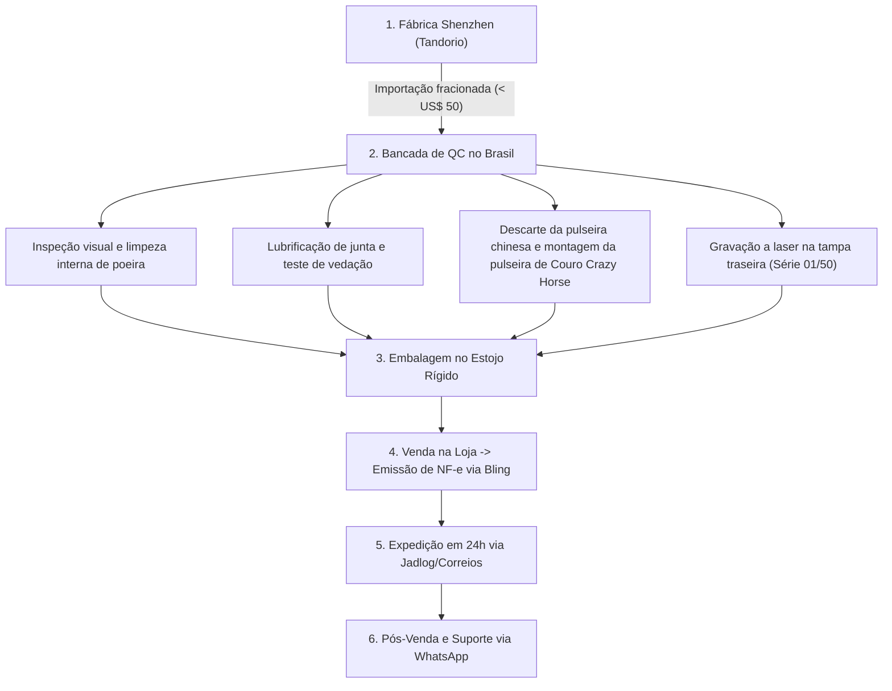

# ⏱️ Aegis Horology (Relojoaria de Especificação)

> **Status Atual**: Validação de Pré-Venda  
> **Prioridade**: Alta  
> **Modelo de Negócio**: E-commerce D2C (Direct-to-Consumer) com agregação de valor local  
> **Complexidade de Execução**: Média  
> **Ticket Médio Estimado**: R$ 749,00 a R$ 789,00 (Relógio + Pulseira adicional no checkout)

---

## 🎯 1. Visão Geral & Proposta de Valor

### O Problema Real
O mercado de relógios masculinos no Brasil sofre de uma assimetria brutal e polarizada de valor:
1. **O Polo dos Shoppings & Grifes de Moda (R$ 800 a R$ 2.500):** Marcas de vestuário e grifes licenciadas (Armani Exchange, Fossil, Diesel, Tommy Hilfiger) e linhas populares vendem produtos com **vidro de cristal mineral** (que risca no primeiro esbarrão em parede), caixas de ligas leves ou aço básico e movimentos de quartzo chineses de US$ 2 a US$ 3. O consumidor paga 80% de markup de vitrine e aluguel de shopping.
2. **O Polo das Plataformas / Dropshipping (R$ 50 a R$ 150):** Relógios da Shopee, AliExpress e lojas genéricas de Instagram (Curren, Naviforce, Megir, Lige) feitos de liga de zinco cromada que descasca com o suor em 3 meses, vidros acrílicos frágeis e sem qualquer vedação real contra água.
3. **A Lacuna de Mercado:** Homens de 25 a 45 anos que buscam maturidade visual, sobriedade e sofisticação ("quiet luxury"), mas se recusam a pagar R$ 1.800 em um relógio de shopping com vidro mineral riscado e têm vergonha de usar um relógio descartável de R$ 80 ou um smartwatch de borracha em jantares e reuniões de negócios.

### A Solução
Criar uma **microbrand brasileira D2C de relógios de especificações técnicas intransigentes**:
* **Hardware Base de Nível Superior:** Caixa usinada em Aço Cirúrgico 316L (39mm), Cristal de Safira real resistente a arranhões com tratamento antirreflexo (AR), coroa rosqueada com vedação real de 200m (20ATM) e mecanismo híbrido **Seiko / TMI VH31 Sweep Quartz** (ponteiro de segundos com movimento contínuo e suave a 4 batimentos/segundo, simulando a estética mecânica com a robustez e precisão do quartzo).
* **Agregação de Valor Nacional (O "Fator Engenheiro"):**
  * Descarte da pulseira original chinesa de baixa qualidade e substituição por pulseiras nacionais de **Couro Legítimo Crazy Horse** com pinos de engate rápido (*quick-release*).
  * Controle de qualidade manual (QC) peça por peça pelo fundador (eliminação de poeira sob o cristal, teste de vedação e alinhamento de ponteiros).
  * Estojo rígido premium com berço aveludado, flanela de microfibra e certificado de garantia de 1 ano assinado à mão com número de série individual.
  * Despacho em 24h a partir do Brasil com frete segurado via Jadlog/Correios.

### Proposta Única de Valor (UVP)
> *"O nível de engenharia, cristal de safira e aço 316L que uma grife de shopping cobraria R$ 2.500, pelo preço honesto de R$ 749, com envio imediato e garantia nacional de 1 ano."*

---

## 👥 2. Público-Alvo & ICP (Perfil de Cliente Ideal)

### Quem é o Cliente Ideal (ICP)
* **Demografia:** Homens, 25 a 45 anos, residentes em capitais e polos econômicos (Sul e Sudeste concentram 70% das compras).
* **Ocupação:** Engenheiros, profissionais de TI/Desenvolvedores, analistas de mercado, advogados, médicos, empresários e entusiastas de tecnologia/EDC (*Everyday Carry*).
* **Renda Individual:** R$ 5.000 a R$ 25.000/mês.
* **Comportamento & Estilo de Vida:** Consomem marcas como *Oficina Reserva, Yuool, Nordweg, Minimal Club, Insider Store*. Valorizam funcionalidade, durabilidade técnica, design limpo sem ostentação espalhafatosa e decisões racionais de compra.

### Onde Encontrá-los em Massa
* **Meta Ads (Instagram & Facebook):** Segmentação aberta ou lookalike baseada em interesses: *Relógios mecânicos, Seiko, Omega, Tissot, Engenharia, Arquitetura, Café Especial, EDC, Carros Clássicos*.
* **Comunidades e Conteúdo Orgânico:** Fóruns do Reddit (*r/relogios, r/EDC, r/ChineseWatches*), canais do YouTube sobre relojoaria e estilo masculino inteligente (*Canal do Relógio, GMT Men, Macho Moda*).

### Gatilhos de Compra
1. **A Prova Brutal (Visual Proof):** Ver um teste em vídeo passando estilete ou broca no cristal de safira e testador de diamante (*Diamond Selector II*) apitando sem deixar riscos.
2. **O Efeito Visual do Movimento:** O vídeo macro mostrando o ponteiro do Seiko VH31 deslizando suavemente sem o "salto" de quartzo barato.
3. **Escassez e Exclusividade Técnica:** Lotes pequenos numerados (ex: *Lote Fundador 01/50*).
4. **Segurança de Compra Local:** Saber que o relógio está no Brasil, com envio em 24h, garantia real e nota fiscal.

### Roteiro de Entrevista "The Mom Test" (5 Perguntas Sem Viés)
1. *"Qual foi o último relógio que você comprou ou ganhou, e o que te fez escolher exatamente aquele modelo naquele momento?"*
2. *"Quanto você pagou nele e onde comprou? Se foi online ou em shopping, como foi a decisão de passar o cartão?"*
3. *"Pensando nos relógios que você já teve ou parou de usar: o que mais te irritou neles com o tempo de uso? (Ex: vidro que riscou, pulseira que esfarelou, bateria que acabou na hora errada, água que entrou)?"*
4. *"Quando você vê relógios de marcas conhecidas de moda (tipo Armani Exchange, Tommy Hilfiger, Vivara) custando R$ 1.500 a R$ 2.500, qual é a sua leitura sincera sobre o que você está pagando ali?"*
5. *"Você já comprou algum acessório masculino (como botas de couro, carteira, óculos escuros ou mochila) de uma marca independente nacional que conheceu pelo Instagram? Como foi a experiência e o que te deu coragem de comprar?"*

---

## 💰 3. Modelo Financeiro & Unit Economics

### DRE por Unidade Vendida (Preço de Venda Base: R$ 749,00)
A precificação foi ajustada para R$ 749,00 para suportar a nova tributação de importação e o CAC inicial no Meta Ads com margem de segurança.

| Indicador / Linha de Custo | Estimativa (R$) | % da Receita | Detalhe / Racional |
| :--- | :--- | :--- | :--- |
| **Receita Bruta de Venda** | **R$ 749,00** | **100,0%** | Modelo Tandorio 39mm VH31 customizado. |
| Impostos de Saída (Simples Nacional) | -R$ 37,45 | 5,0% | Anexo I (Comércio) faixa inicial até R$ 180k/ano. |
| Gateway de Pagamento & Antecipação D+2 | -R$ 52,43 | 7,0% | Mercado Pago / Appmax considerando cartão em até 6x. |
| Frete Médio Nacional com Seguro | -R$ 35,00 | 4,7% | Correios PAC / Jadlog via Melhor Envio com seguro total. |
| **Receita Líquida Operacional** | **R$ 624,12** | **83,3%** | Caixa disponível após deduções fiscais e de pagamento. |
| Custo do Relógio Desembarcado (FOB + Frete + Impostos) | -R$ 345,00 | 46,1% | US$ 42 FOB + US$ 6 frete = R$ 240 + ~44% tributação (abaixo de US$ 50). |
| Pulseira de Couro Legítimo Crazy Horse (Nacional) | -R$ 28,00 | 3,7% | Substituição obrigatória da pulseira rígida de fábrica. |
| Kit Embalagem (Caixa Rígida + Flanela + Certificado) | -R$ 35,00 | 4,7% | Estojo rígido estruturado de alto padrão de unboxing. |
| **Margem de Contribuição 1 (Antes do Tráfego)** | **R$ 216,12** | **28,8%** | Margem disponível para cobrir marketing e gerar lucro. |
| CAC Alvo (Custo por Cliente no Meta Ads) | -R$ 150,00 | 20,0% | ROAS alvo de ~5.0x na receita (ou CAC de R$ 150 no tráfego frio). |
| **Lucro Líquido Final por Unidade** | **R$ 66,12** | **8,8%** | **Lucro líquido limpo por unidade vendida.** |

### Métricas Consolidadas e Metas de Retorno

| Indicador / Métrica | Estimativa | Detalhe / Racional |
| :--- | :--- | :--- |
| **Custo Inicial de Validação (MVP)** | **R$ 800,00** | 2 amostras com taxas (R$ 500) + R$ 300 em anúncios de teste. |
| **Investimento no Lote 01 (30 peças)** | **R$ 12.240,00** | Capital de giro para primeiro lote de relógios, pulseiras e caixas. |
| **Preço de Venda Médio** | **R$ 749,00** | Posicionamento entre grifes de moda e dropshipping. |
| **Margem Bruta Alvo** | **28,8%** | Margem de contribuição antes do investimento em marketing. |
| **CAC Alvo (Meta Ads)** | **R$ 150,00** | Custo máximo aceitável para aquisição no tráfego frio. |
| **LTV Estimado (12 meses)** | **R$ 950,00** | Relógio principal (R$ 749) + recompra de 2 pulseiras extras (R$ 200). |
| **Meta de R$ 5.000 Líquidos no Bolso** | **76 peças/mês** | Faturamento bruto mensal de R$ 56.924,00. |

---

## 🛠️ 4. Arquitetura Operacional & Logística

### Camada de Apresentação / Frontend
* **Plataforma:** Shopify ou Nuvemshop com tema customizado ultra-clean e minimalista (layout inspirado em *Baltic Watches* e *Hodinkee*).
* **Página de Produto Único (Landing Page):**
  * Tipografia técnica e sóbria (*Inter* ou *Söhne*).
  * Vídeos curtos em loop no topo mostrando o deslizar do ponteiro e reflexo da safira.
  * Tabela de comparação explícita: *Aegis vs. Relógio de Grife de Shopping (R$ 1.800) vs. Relógio da Shopee (R$ 80)*.
  * Seção detalhada sobre as especificações do calibre Seiko VH31.

### Backend, Ferramentas & Integrações
* **Checkout & Gateway:** Appmax ou Mercado Pago (máxima aprovação de cartão de crédito e PIX com desconto de 5%).
* **ERP & Fiscal:** Bling ERP integrado com a SEFAZ para emissão automática de NF-e e controle de estoque de SKUs de pulseiras.
* **Logística:** Melhor Envio / Nuvem Envio conectado à Jadlog e Correios (com cotação dinâmica de frete no checkout).
* **Rastreamento & Pós-Venda:** Z-API / WhatsApp Business API enviando atualizações de envio e link de rastreio em tempo real.
* **Pixel & Tracking:** Meta Conversions API (CAPI) via servidor para mensuração de conversões sem perda por bloqueadores de cookies.

### Fluxo Operacional Passo a Passo

* **Customização de Logotipo com Fornecedor:** Negociação direta com a loja oficial da Tandorio no AliExpress para serviço de **tampografia de fábrica no mostrador** (taxa única de matriz de clichê de US$ 15 a US$ 25), garantindo acabamento profissional idêntico a relógios de alta gama.

---

## 📣 5. Estratégia de Go-to-Market (GTM) & Vendas

### Canais de Aquisição Iniciais
* **Meta Ads (Instagram Reels / Stories):** Tráfego direto para a landing page com criativos em vídeo vertical (9:16) focados em demonstração técnica e sensorial.
* **Parcerias de Permuta:** Envio de 3 unidades do primeiro lote para influenciadores e canais de estilo masculino / EDC no YouTube para review orgânico sem roteiro forçado.

### Ideias de Ângulos de Anúncios / Criativos (Hooks Fortes)

* **Ângulo 1: O Teste de Destruição (Brutal Proof)**
  * **Hook (0-3s):** Close macro de uma broca de aço ou lâmina de estilete raspando com força o vidro do relógio.
  * **Roteiro:** *"Se você pagar R$ 1.500 em um relógio de shopping, você ganha um vidro mineral que risca na parede de casa. Nós colocamos cristal de safira real, caixa em aço 316L e máquina japonesa Seiko em um relógio que custa metade do preço. Veja o teste do diamante apitando ao vivo."*
  * **CTA:** *"Conheça o Lote Fundador da Aegis Horology."*

* **Ângulo 2: O Fim do Quartzo "Pulante"**
  * **Hook (0-3s):** Comparação lado a lado em tela dividida: de um lado, o ponteiro de um relógio comum dando saltos secos de 1 segundo; do outro, o ponteiro do Aegis deslizando suavemente.
  * **Roteiro:** *"Por que quase todo relógio acessível parece barato no pulso? Por causa desse salto feio do ponteiro dos segundos. O Aegis utiliza o calibre japonês Seiko VH31 Sweep Quartz: 4 batimentos por segundo de pura fluidez mecânica, sem exigir que você dê corda todo dia."*
  * **CTA:** *"Garanta o seu com envio imediato e 1 ano de garantia."*

### Oferta de Entrada (A Validação de Pré-Venda Sem Risco)
* **A Mecânica de "Reserva VIP de R$ 29,00":**
  * Na landing page, o botão principal é: **"Garantir Vaga no Lote Fundador (01/50) por R$ 29,00"**.
  * O cliente paga R$ 29,00 via PIX ou cartão (compromisso financeiro real). Esse valor é abatido no pagamento final quando o lote desembarcar no Brasil, garantindo R$ 200 de desconto (de R$ 890 por R$ 690).
  * **Critério de Validação:** Se 15 a 20 pessoas pagarem a reserva com menos de R$ 300 de tráfego, a demanda real está comprovada e a compra do lote de 30 unidades na China é autorizada com risco financeiro praticamente zerado.

---

## ⚠️ 6. Riscos, Desafios & Mitigações

1. **Risco 1: Sobretaxação Aduaneira Acima de US$ 50**
   * *Descrição:* Caso o pacote consolidado seja enquadrado na alíquota cheia de importação postal (60% II + ICMS por dentro = ~92% a 105% efetivo), o custo do relógio salta para mais de R$ 500, eliminando a margem da empresa.
   * *Mitigação:* Na fase de validação e primeiros lotes, importar em remessas fracionadas mantendo cada remessa estritamente abaixo de US$ 50 no programa Remessa Conforme (alíquota de 20% II + ICMS). Na fase de escala (acima de 100 peças), migrar formalmente para importação comercial via Radar Siscomex/Trading marítima consolidada (LCL), onde o Imposto de Importação real de relógios de pulso na NCM é de apenas 20%, e não os 60% do regime postal simplificado.

2. **Risco 2: Devoluções por Insatisfação com a Pulseira Original Chinesa**
   * *Descrição:* A pulseira de fábrica da Tandorio possui toque rígido, acabamento frágil e odor químico, o que destrói a percepção de valor no unboxing e gera devoluções pelo Código de Defesa do Consumidor (direito de arrependimento em 7 dias).
   * *Mitigação:* Tolerância zero com a pulseira original de fábrica. O relógio é entregue ao cliente exclusivamente com pulseira artesanal nacional de couro legítimo bovino Crazy Horse com pinos de engate rápido (*quick-release*), elevando instantaneamente a experiência tátil e visual.

3. **Risco 3: Falhas Mecânicas e Custos de Pós-Venda (RMA)**
   * *Descrição:* Clientes acionando garantia por desalinhamento de ponteiros decorrente de impacto no transporte ou necessidade de troca de bateria.
   * *Mitigação:* A adoção do calibre **Seiko VH31 Sweep Quartz** elimina 90% dos defeitos típicos de relógios mecânicos automáticos (descalibração de espiral após quedas leves). Para os 10% restantes, estruturar uma parceria de prestação de serviços com um relojoeiro autônomo local em sua cidade por um valor fixo de R$ 30 por atendimento.

---

## 🗺️ 7. Roadmap de Execução & Checklist de Próximos Passos

### Fase 1: Validação Técnica & Amostras (Dias 1 a 15)
- [ ] Comprar 2 amostras estéreis da Tandorio 39mm VH31 no AliExpress (1 mostrador preto, 1 mostrador branco/creme).
- [ ] Comprar 2 pulseiras de couro legítimo Crazy Horse (20mm) com pinos de engate rápido no Mercado Livre.
- [ ] Comprar 1 estojo rígido para relógio e 1 testador de diamante (*Diamond Selector II*) para as gravações.
- [ ] Inspecionar o maquinário na bancada, desmontar a tampa traseira e testar a durabilidade do cristal com estilete.

### Fase 2: Produção de Mídia & Landing Page (Dias 16 a 30)
- [ ] Gravar 5 variações de criativos em vídeo (Teste do estilete, teste do diamante, sweep do ponteiro no pulso, unboxing com pulseira de couro).
- [ ] Criar landing page de pré-venda com foco em reserva VIP de R$ 29,00.
- [ ] Configurar conta de anúncios no Meta Ads e instalar Pixel de conversão com evento de compra/reserva.
- [ ] Rodar R$ 300 em tráfego pago (R$ 50/dia durante 6 dias).
- [ ] **Gate de Decisão:** Obter no mínimo 15 reservas pagas de R$ 29 para autorizar a compra do lote de produção.

### Fase 3: Produção do Primeiro Lote & Lançamento (Dias 31 a 60)
- [ ] Contatar o vendedor oficial da Tandorio e negociar o primeiro lote de 30 unidades com logotipo customizado no mostrador via tampografia de fábrica.
- [ ] Comprar 30 pulseiras de couro legítimo no atacado nacional.
- [ ] Produzir 30 caixas rígidas personalizadas, certificados numerados e flanelas de microfibra.
- [ ] Receber o lote, realizar o QC completo (limpeza, vedação e troca de pulseiras) e numerar a laser a tampa traseira (01/30 a 30/30).
- [ ] Cobrar o saldo restante dos clientes da pré-venda e despachar em 24h via Jadlog/Correios.
- [ ] Coletar depoimentos em vídeo dos primeiros clientes para abastecer os anúncios perpétuos de escala.
