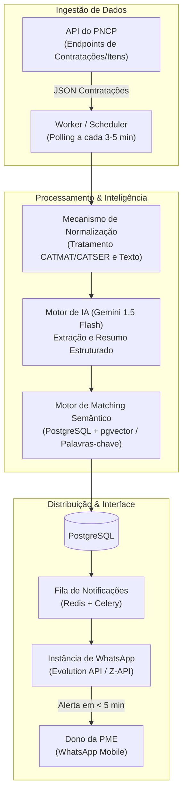

# 📡 RadarGov — Inteligência em Dispensas Eletrônicas

> **Status Atual**: Validação (Piloto Concierge)  
> **Prioridade**: Alta  
> **Modelo de Negócio**: B2B Micro-SaaS (Assinatura Recorrente Mensal / Trimestral)  
> **Complexidade de Execução**: Baixa / Média  
> **Ticket Médio Estimado**: R$ 147,00 a R$ 197,00 / mês  

---

## 🎯 1. Visão Geral & Proposta de Valor

### O Problema Real
Com a vigência obrigatória e integral da **Nova Lei de Licitações e Contratos Administrativos (Lei nº 14.133/2021)**, as antigas compras diretas em papel ou cotações informais foram substituídas pelas **Dispensas Eletrônicas (Art. 75, incisos I e II)**, cujo aviso deve ser obrigatoriamente publicado no **Portal Nacional de Contratações Públicas (PNCP)** com antecedência mínima de **3 dias úteis** (Art. 75, § 3º).

Esse cenário gerou uma ineficiência brutal para Pequenas e Médias Empresas (PMEs) fornecedoras:
1. **Janela Temporal Crítica**: O prazo de envio de propostas e a fase de lances são extremamente curtos (frequentemente poucas horas de disputa aberta).
2. **Cegueira Operacional**: Pequenos distribuidores não têm um setor de inteligência de mercado ou tempo para ficar dando F5 no PNCP ou nos portais de compras ao longo do dia.
3. **Complexidade e Ruído das Soluções Existentes**: Softwares tradicionais de licitação (Effecti, ConLicitação, SigaPregão) foram desenhados para pregões eletrônicos complexos, custam caro (R$ 400 a R$ 1.500/mês com fidelidade anual) e geram centenas de alertas diários irrelevantes ("lixão de editais"), obrigando o empresário a ler PDFs de 40 páginas para descobrir se pode cotar.
4. **Custo da Omissão**: As PMEs perdem contratos rápidos de R$ 5.000 a R$ 50.000 em suas próprias cidades e regiões porque simplesmente não ficaram sabendo a tempo da publicação.

### A Solução
O **RadarGov** é um Micro-SaaS ultra-focado e *mobile-first* que ingere continuamente os dados da API pública do PNCP, aplica inteligência semântica e filtros geográficos rigorosos e envia alertas executivos instantâneos diretamente no **WhatsApp** do tomador de decisão.

Em vez de enviar links brutos ou PDFs anexos, o produto entrega:
- **Resumo Executivo em 5 linhas** gerado por IA (objeto mastigado, valor total de referência, data/hora limite da proposta, sistema de disputa e exigências pontuais).
- **Filtro de Raio Logístico**: Apenas oportunidades em cidades ou distâncias onde o fornecedor tem viabilidade de entrega.
- **Botão "Checklist Rápido"**: Extração instantânea das certidões e exigências de habilitação simplificada daquela dispensa específica.

### Proposta Única de Valor (UVP)
> *"Todas as vendas diretas de órgãos públicos no seu raio de entrega, mastigadas no seu WhatsApp em menos de 5 minutos após a publicação, sem login em dashboards e sem ler editais de 40 páginas."*

---

## 👥 2. Público-Alvo & ICP (Perfil de Cliente Ideal)

### Quem é o Cliente Ideal (ICP)
- **Perfil Empresarial**: Pequenas e médias distribuidoras, prestadoras de serviços locais e comércios atacadistas (faturamento entre R$ 30k e R$ 300k/mês).
- **Segmentos Prioritários**:
  - Suprimentos de Informática e Toners/Impressão.
  - Materiais de Escritório e Papelaria.
  - Produtos de Limpeza, Higiene e Descartáveis.
  - Equipamentos de Proteção Individual (EPIs).
  - Manutenção de Ar-Condicionado e Pequenos Reparos Prediais.
  - Gêneros Alimentícios / Merenda Escolar / Cestas Básicas.
- **Maturidade Regulatória**: Empresas que **já possuem CNPJ ativo**, têm certidões fiscais em dia (ou capacidade de regularizá-las rapidamente) e que já venderam ou tentam vender ativamente para órgãos públicos.
- **Tomador de Decisão**: O próprio dono/sócio, o diretor comercial ou o único auxiliar dedicado a licitações da empresa.

### Onde Eles Estão (Canais de Prospecção)
1. **Portais de Transparência e Diários Oficiais**: Mineração de CNPJs de empresas que venceram ou participaram de dispensas ou pregões nos últimos 12 meses nos municípios-alvo.
2. **Google Maps & Cadastros Comerciais Locais**: Busca ativa de distribuidores e atacadistas regionais.
3. **LinkedIn**: Busca por cargos como "Gerente Comercial", "Diretor", "Analista de Licitações" em empresas do ramo de distribuição/suprimentos.
4. **Associações Comerciais e CDLs (Câmaras de Dirigentes Lojistas)**: Núcleos setoriais de compras governamentais e rodadas de negócios.

### Gatilhos de Compra
- **Gatilho da Perda Recente (Custo da Omissão)**: Ver que uma entidade pública vizinha (ex: Instituto Federal ou Prefeitura vizinha) comprou R$ 30.000 do produto que ele vende e foi homologada para um concorrente de fora do estado por falta de cotação local.
- **Economia de Mão de Obra**: Eliminar a necessidade de colocar um funcionário CLT de R$ 1.600/mês para buscar editais manualmente.
- **Velocidade de Retorno (ROI Tangível)**: Uma única dispensa de R$ 12.000 com margem de 20% gera R$ 2.400 de lucro líquido, pagando mais de 1 ano de assinatura do SaaS.

---

## 💰 3. Modelo Financeiro & Unit Economics

### Tabela de Métricas e Estimativas

| Indicador / Linha | Estimativa | Detalhe / Racional |
| :--- | :--- | :--- |
| **Custo Inicial de Validação (MVP)** | **R$ 250,00** | Custo de setup de instância de WhatsApp (Evolution/Z-API), domínio e saldo de OpenAI/Gemini API para testes manuais. |
| **Custo de Operação / Cliente / Mês (COGS)** | **R$ 15,00 a R$ 25,00** | Infraestrutura compartilhada (VPS), frações de centavos por chamada de IA para resumos e custo de gateway/mensageria. |
| **Preço de Venda / Mensalidade** | **R$ 147,00 / mês** (ou R$ 397/trimestre) | Ticket posicionado para filtrar curiosos e gerar valor percebido como ferramenta de negócios profissional. |
| **Margem Bruta Alvo** | **83% a 88%** | Descontando impostos (Simples Nacional ~6%), taxas de gateway (Asaas ~3-4%) e infraestrutura direta. |
| **CAC Alvo (Custo de Aquisição)** | **R$ 80,00 a R$ 120,00** | Venda outbound ativa realizada pelo fundador no início; migração para tráfego pago geolocalizado no pós-validação. |
| **LTV Estimado (Lifetime Value)** | **R$ 1.837,00** | Considera ticket de R$ 147/mês com taxa de churn de 8% ao mês (vida média do cliente de 12,5 meses). |
| **Payback do CAC** | **< 1 mês** | O custo de aquisição é recuperado integralmente logo na primeira mensalidade do cliente. |

### Racional de Sensibilidade (Churn vs. LTV)

| Cenário | Ticket | Churn Mensal | Vida Média (1/Churn) | LTV Bruto | LTV Líquido (~85%) |
| :--- | :--- | :--- | :--- | :--- | :--- |
| **Conservador** | R$ 97,00 | 10% | 10 meses | R$ 970,00 | R$ 824,50 |
| **Base (Recomendado)** | R$ 147,00 | 8% | 12,5 meses | R$ 1.837,50 | R$ 1.561,87 |
| **Otimista** | R$ 197,00 | 5% | 20 meses | R$ 3.940,00 | R$ 3.349,00 |

> **Diretriz Estratégica de Pricing**: O plano de R$ 97/mês deve ser evitado ou usado apenas como downsell. O cliente de R$ 97 costuma ser desestruturado, exige muito suporte e cancela no segundo mês. O plano de R$ 147/mês a R$ 197/mês atrai quem já opera no mercado e valoriza tempo.

---

## 🛠️ 4. Arquitetura Operacional ou Tecnológica

### Stack Tecnológica Recomendada
- **Camada de Apresentação / Frontend**:
  - *MVP / Fase 1 e 2*: **Sem interface web para o cliente final**. O produto é consumido 100% via WhatsApp. O onboarding e configuração inicial são feitos via formulário web minimalista (Tally / Typeform) integrado ao banco.
  - *Fase 3 (Expansão)*: Painel web simples em **Next.js + Tailwind CSS (shadcn/ui)** apenas para o cliente editar palavras-chave, raio de atuação em KM e consultar histórico de dispensas recebidas.
- **Backend & Processamento de Dados**:
  - **Linguagem & Framework**: Python (FastAPI), aproveitando o ecossistema de manipulação de dados, scraping e integração com IA.
  - **Scheduler & Workers**: Celery + Redis para agendamento de polling na API do PNCP e despacho assíncrono de mensagens.
  - **Banco de Dados**: PostgreSQL com extensão `pgvector` (para buscas por similaridade semântica entre os itens de interesse do cliente e a descrição dos itens da dispensa).
- **Integrações Chave**:
  - **API do PNCP (`pncp.gov.br/api/consulta`)**: Consumo dos endpoints de contratações do tipo "Dispensa de Licitação", status "Recebendo Proposta", com extração dos arquivos de Termo de Referência / Aviso de Dispensa.
  - **Modelos de Linguagem (LLM)**: Google Gemini 1.5 Flash (ou OpenAI GPT-4o-mini). Rápido, com janela de contexto ampla para ingerir o Termo de Referência completo e custo de milésimos de centavo por requisição.
  - **Camada de Mensageria (WhatsApp)**:
    - *Fase de Inicial/Tração*: Evolution API ou Z-API auto-hospedada em VPS dedicada com número empresarial blindado.
    - *Escala*: WhatsApp Cloud API oficial da Meta para mensagens em formato de template transacional e canal alternativo via Telegram Bot.
  - **Gateway de Pagamento**: Asaas ou Mercado Pago (cobrança recorrente via Pix e Cartão de Crédito com suspensão automática de disparos em caso de inadimplência).

### Fluxo Operacional Passo a Passo
1. **Captura Contínua**: O worker consulta a API do PNCP a cada 3 a 5 minutos buscando novas dispensas eletrônicas publicadas no Brasil.
2. **Filtragem Bruta**: Descarta contratações com prazos vencidos, dispensas não-competitivas (Art. 75, outros incisos sem disputa) ou fora dos estados monitorados.
3. **Enriquecimento por IA**: O script faz o download do aviso/termo de referência, envia para a LLM e extrai:
   - Objeto padronizado e simplificado.
   - Valor total estimado/referência.
   - Prazos exatos de cadastro de proposta e sessão de lances.
   - Sistema de disputa onde ocorrerá o certame (Compras.gov.br, BEC, Licitações-e, Portal de Compras Públicas, etc.).
   - Requisitos de habilitação específicos (exige certidão X, amostra física ou visita técnica?).
4. **Cruzamento de Preferências (Matching)**:
   - O sistema cruza os itens da dispensa com o perfil cadastrado do cliente (Segmento + Palavras-chave positivas/negativas + Raio geográfico em KM).
5. **Disparo Instantâneo**: Se a aderência for superior a 90%, uma mensagem formatada e limpa cai no WhatsApp do cliente em menos de 5 minutos após a publicação oficial.

---

## 📣 5. Estratégia de Go-to-Market (GTM) & Vendas

### Canais de Aquisição Iniciais
1. **Outbound Direto com a "Auditoria de Oportunidades Perdidas"**:
   - Abordagem ativa via WhatsApp e ligação para donos de distribuidoras locais.
   - Abertura mostrando dinheiro deixado na mesa na semana anterior.
2. **Parcerias Estratégicas com Contadores e Consultores de Licitação**:
   - Contadores atendem dezenas de PMEs que querem faturar mais.
   - Consultores de licitação focam em grandes pregões e não têm tempo para caçar dispensas pequenas; o RadarGov pode ser oferecido como ferramenta complementar com comissão de 20% recorrente para o parceiro.
3. **Conteúdo Educacional Rápido (LinkedIn / Instagram / Reels)**:
   - Vídeos curtos do fundador mostrando: *"Como uma papelaria de cidade pequena faturou R$ 18.000 em 3 dias com uma dispensa do Art. 75 que ninguém viu."*

### Ganchos de Mensagens e Criativos

#### Gancho 1: Oportunidade Real na Mesa (Frio / Específico)
> **Assunto/Mensagem**: *"Você viu essa compra da [Órgão da Região] ontem?"*  
> **Corpo**: *"Olá [Nome], vi que vocês distribuem informática aqui no estado. Ontem a [Universidade Federal / Prefeitura X] abriu uma dispensa eletrônica de R$ 24.000 em toners para encerrar propostas na sexta. O edital tem 3 páginas e quase nenhuma concorrência local cadastrada. Vocês chegaram a cotar? Nós monitoramos 100% dessas compras rápidas no estado e avisamos direto no seu WhatsApp para você não perder prazos curtos como esse."*

#### Gancho 2: A Comparação do Custo Operacional (Financeiro)
> **Assunto/Mensagem**: *"Quanto custa o tempo da sua equipe caçando edital no PNCP?"*  
> **Corpo**: *"Ficar abrindo 5 portais de compras e lendo termos de referência de 50 páginas consome 2 horas por dia do seu setor comercial. Criamos um radar que filtra tudo por IA e joga no seu WhatsApp apenas as compras da Lei 14.133 que a sua empresa consegue entregar hoje. Custa menos de R$ 5 por dia."*

### Oferta de Entrada (Para os Primeiros 10 Clientes)
- **Piloto Fundador (Garantia Total)**:
  - R$ 100 no primeiro mês (desconto de ~30% sobre os R$ 147 futuros).
  - Onboarding individual via WhatsApp conduzido pelo próprio Iury, configurando os filtros exatos de produtos e cidades atendidas.
  - **Garantia Incondicional de 15 Dias**: Se nos primeiros 15 dias o cliente não receber pelo menos 3 oportunidades reais e viáveis para a operação dele, o valor é estornado imediatamente via Pix.

---

## ⚠️ 6. Riscos, Desafios & Mitigações

### 1. O "Churn de Frustração" (Cliente recebe alertas, mas não ganha nenhuma disputa)
- **Descrição do Risco**: O cliente assina o serviço achando que ser avisado garante a venda. Ele entra na disputa, perde no preço para concorrentes agressivos de outros estados, ou descobre que está com certidão negativada, conclui que o software "não funciona" e cancela no mês 2.
- **Mitigação Preventiva**:
  - **Qualificação Rígida no Onboarding**: Vender exclusivamente para empresas que já têm estrutura de entrega e certidões ativas.
  - **Inteligência Logística como Filtro**: Priorizar alertas de órgãos que exigem prazo de entrega curto (ex: 24 a 72 horas), o que inviabiliza aventureiros de fora do estado e protege a margem da distribuidora local.
  - **Conteúdo de Ativação**: Enviar junto com o alerta dicas práticas de precificação e conferência de habilitação simplificada.

### 2. Dados Ruidosos, Fragmentados ou Fora do Padrão no PNCP
- **Descrição do Risco**: Muitos municípios do interior preenchem itens com descrições genéricas (ex: "aquisição de materiais diversos"), cadastram códigos CATMAT errados ou publicam o aviso no PNCP horas antes do encerramento da proposta, gerando alertas truncados ou intempestivos.
- **Mitigação Preventiva**:
  - **Camada de Enriquecimento por LLM**: A IA não lê apenas o título do item; ela analisa o arquivo anexo do Termo de Referência para extrair a lista real de produtos e o prazo de lances.
  - **Limpeza de Falsos Positivos**: Implementação de lista negativa robusta (ex: descartar automaticamente dispensas cujo tipo de disputa seja "Sem Disputa" ou inexigibilidade disfarçada).

### 3. Instabilidade e Risco de Banimento de Canais no WhatsApp
- **Descrição do Risco**: O uso de APIs não-oficiais do WhatsApp para envio de notificações pode ocasionar o bloqueio temporário ou definitivo do número comercial da plataforma, interrompendo o serviço e destruindo a confiança do cliente.
- **Mitigação Preventiva**:
  - **Arquitetura Multi-Canal desde a Origem**: O cliente cadastra o WhatsApp, mas tem como espelho obrigatório um canal exclusivo no **Telegram** ou notificações Push em um PWA.
  - **Comportamento Anti-Spam**: O volume de alertas deve ser mantido estritamente cirúrgico (1 a 4 alertas altamente qualificados por dia, nunca disparos em massa).
  - **Migração Rápida para a Cloud API Oficial**: Assim que atingir 30 clientes pagantes, migrar as notificações para a API oficial da Meta utilizando templates aprovados de utilidade.

---

## 🗺️ 7. Roadmap de Execução & Checklist de Próximos Passos

### Fase 1: Validação Concierge & Pré-Vendas (Dias 1 a 15)
- [ ] Extrair do PNCP manualmente 5 exemplos reais de dispensas eletrônicas com alta margem publicadas na última semana no estado-alvo.
- [ ] Mapear uma lista de 30 distribuidoras locais (informática, papelaria ou limpeza) com contato direto dos sócios/gerentes.
- [ ] Executar o roteiro de 5 perguntas do *The Mom Test* com 3 empresários para calibrar as dores reais de monitoramento.
- [ ] Rodar o experimento Concierge de 48 horas: enviar dossiês manuais de oportunidades no WhatsApp e fechar os **primeiros 3 clientes pagando R$ 100 adiantados via Pix**.
- [ ] Operar o monitoramento manualmente (ou via script local descartável de terminal) para esses 3 clientes durante 15 dias, coletando feedback diário sobre a qualidade dos alertas.

### Fase 2: Construção do MVP Automatizado (Dias 16 a 45)
- [ ] Estruturar o banco de dados PostgreSQL com tabelas de `Contratações`, `Itens`, `Clientes` e `Preferencias_Filtro`.
- [ ] Desenvolver o worker em Python/FastAPI para consumo incremental da API do PNCP (`/v1/orgaos/.../compras`).
- [ ] Integrar a pipeline de extração com Google Gemini 1.5 Flash para geração automática dos resumos executivos em 5 linhas.
- [ ] Configurar instância da Evolution API / Z-API em VPS para disparo automático dos resumos no WhatsApp.
- [ ] Criar formulário de onboarding estruturado (Tally) para coletar dados cadastrais, raio de atendimento e palavras-chave dos novos assinantes.
- [ ] Integrar checkout de pagamentos recorrentes via Asaas (Pix e Cartão).

### Fase 3: Lançamento Comercial & Primeiras Vendas (Dias 46 a 60)
- [ ] Migrar os clientes do piloto manual para o fluxo 100% automatizado.
- [ ] Executar rotina outbound diária: 15 novas abordagens personalizadas por dia com o gancho da "Auditoria de Oportunidades Perdidas".
- [ ] Atingir a marca de **20 clientes pagantes ativos** (MRR de ~R$ 3.000,00 com custo operacional < R$ 250,00).
- [ ] Avaliar a taxa de retenção dos primeiros 30 dias e ajustar os filtros anti-ruído com base nos cancelamentos ou solicitações de suporte.
